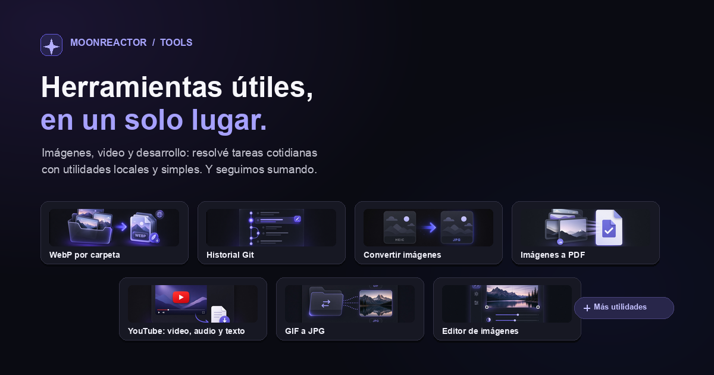

# Moonreactor Tools Hub



Un sitio web con herramientas prácticas para trabajar con imágenes, video y repositorios Git. El frontend está hecho con Next.js y el backend con FastAPI. Docker Compose inicia ambos servicios.

## Herramientas disponibles

- **Optimizar para web** (`/tools/optimize-for-web`): convierte imágenes de una carpeta y sus subcarpetas a WebP. Conserva los originales en una carpeta de respaldo, muestra el ahorro de peso y permite ajustar la calidad. Se ejecuta en el navegador y funciona en Chrome o Edge.
- **Historial Git** (`/tools/git-history`): explora commits y ramas, busca texto en mensajes y permite editar los mensajes de una rama activa con vista previa y respaldo. Para acceder a repositorios de la computadora se necesita iniciar además el servicio local descrito más abajo.
- **Conversor de imágenes** (`/tools/image-converter`): convierte formatos como HEIC, AVIF y WebP a JPG o PNG.
- **Editor de imágenes** (`/tools/image-editor`): recorta, ajusta brillo, contraste y saturación, aplica filtros y descarga una copia o reemplaza el archivo según el flujo del navegador.
- **Imágenes a PDF** (`/tools/images-to-pdf`): combina varias imágenes en un PDF, con una imagen por página.
- **Descargador de YouTube** (`/tools/youtube-downloader`): obtiene video, audio o transcripción desde un enlace; permite elegir opciones de formato y recortar un tramo.
- **GIF a JPG** (`/tools/gif-to-jpg`): recorre una carpeta local y sus subcarpetas, convierte GIF a JPG y reemplaza los GIF originales. Requiere Chrome o Edge y permiso de acceso a la carpeta.

## Empezar desde cero (recomendado: Docker)

Esta es la forma más sencilla de ejecutar el proyecto. No hace falta instalar Node.js ni Python: Docker ejecuta el frontend y el backend en contenedores.

### 1. Instalar Docker

Instalá **Docker Desktop** para tu sistema operativo y abrilo. Esperá a que indique que Docker está en ejecución.

- macOS o Windows: [descargar Docker Desktop](https://www.docker.com/products/docker-desktop/)
- Linux: instalá Docker Engine y el complemento Docker Compose según la documentación de Docker.

### 2. Descargar el proyecto

Si ya tenés este repositorio en tu computadora, abrí una terminal y entrá en su carpeta. Si no, clonalo con Git (reemplazá la URL por la del repositorio):

```bash
git clone <URL_DEL_REPOSITORIO>
cd tools-varias
```

### 3. Abrir una terminal en la carpeta del proyecto

La carpeta correcta es la que contiene `Makefile`, `docker-compose.yml` y este `README.md`. En VS Code podés abrir esa carpeta y elegir **Terminal → Nueva terminal**.

### 4. Iniciar el sitio

Ejecutá este comando para iniciar el sitio sin configurar YouTube:

```bash
docker compose -f docker-compose.yml -f docker-compose.dev.yml up --build
```

La primera vez Docker descargará imágenes e instalará dependencias; puede tardar varios minutos. El comando deja la terminal ocupada mostrando los registros: mantenela abierta mientras usás el sitio.

Cuando los servicios estén listos, abrí [http://localhost:3000](http://localhost:3000). La API está en [http://localhost:8000](http://localhost:8000) y su documentación en [http://localhost:8000/docs](http://localhost:8000/docs).

### 5. Detener el sitio

Volvé a la terminal donde corre Docker Compose y presioná **Ctrl+C**. Después ejecutá:

```bash
make down
```

Para volver a iniciarlo otro día, abrí Docker Desktop, una terminal en la carpeta del proyecto y ejecutá otra vez el comando de inicio.

### Problemas frecuentes

- **«Cannot connect to the Docker daemon»**: abrí Docker Desktop, esperá a que arranque y volvé a ejecutar el comando de inicio.
- **«port is already allocated»**: otra aplicación está usando el puerto 3000 o 8000. Cerrá esa aplicación y probá de nuevo.
- **`make: command not found`**: en Windows, usá WSL con Docker Desktop o ejecutá los comandos de Docker Compose directamente.
- **No aparece una herramienta o el frontend no carga datos**: esperá unos segundos y recargá la página. También podés revisar los registros de la terminal.

## YouTube: configuración opcional

El resto del hub puede iniciarse sin configurar YouTube. Para descargar contenido de YouTube, podés sincronizar cookies del navegador. Necesitás tener `yt-dlp` instalado y una sesión abierta en el navegador elegido.

En macOS, instalalo con:

```bash
brew install yt-dlp
```

Después iniciá sesión en YouTube en Chrome y ejecutá `make youtube-cookies`. Si usás otro navegador, indicá su nombre:

```bash
BROWSER=firefox make youtube-cookies
```

Las cookies se guardan en `cookies/youtube.txt`, archivo ignorado por Git. Reiniciá el backend para que las tome: `docker compose restart backend`. También podés usar `make dev` o `make up`, que intentan sincronizar cookies automáticamente antes de iniciar.

## Historial Git en repositorios de tu computadora

Para que Historial Git abra repositorios locales, iniciá un servicio auxiliar en otra terminal, desde la raíz de este proyecto:

```bash
make git-local
```

Requiere Python 3.10 o superior y Git instalados. Mantené esa terminal abierta mientras usás la herramienta. El servicio escucha solo en tu computadora (`127.0.0.1:8766`) y permite repositorios dentro de tu carpeta de usuario. Para autorizar otra raíz:

```bash
GIT_REPOS_ROOT=/ruta/a/repositorios make git-local
```

En Historial Git, elegí **Elegir carpeta de mi computadora** o ingresá una ruta. El selector nativo de carpeta funciona en macOS con Chrome o Edge; en otros sistemas podés ingresar la ruta manualmente. Si el navegador pregunta si permitís acceso a la red local, aceptalo.

Editar mensajes reescribe los commits seleccionados y sus descendientes de la rama activa, aunque conserva archivos, autores, fechas y merges. La herramienta crea un respaldo local, no hace push y elimina las firmas criptográficas de los commits reescritos. Si esos commits ya se publicaron, coordiná la reescritura con tus colaboradores antes de actualizar el remoto.

## Desarrollo sin Docker (opcional)

Usá esta modalidad solo si ya tenés Python 3.10+, Node.js 20+ y npm instalados. En macOS, el backend también necesita las bibliotecas de imágenes HEIF:

```bash
brew install libheif
```

En una terminal, iniciá el backend:

```bash
cd backend
python3 -m venv .venv
source .venv/bin/activate
pip install -r requirements.txt
uvicorn app.main:app --reload --port 8000
```

En otra terminal, desde la raíz del proyecto, iniciá el frontend:

```bash
cd frontend
npm install
NEXT_PUBLIC_API_URL=http://localhost:8000 npm run dev
```

Abrí [http://localhost:3000](http://localhost:3000). En Windows, activá el entorno virtual con `.venv\Scripts\activate`; para la variable de entorno del frontend usá PowerShell: `$env:NEXT_PUBLIC_API_URL="http://localhost:8000"; npm run dev`.

## Mapa del repositorio

```text
frontend/                 Sitio Next.js y páginas de herramientas
  app/tools/              Una página por herramienta
  public/tools/           Imágenes representativas de las herramientas
  public/og-tools-hub.png Imagen para compartir el sitio (Open Graph)
backend/                  API FastAPI y lógica de servidor
  app/tools/              Routers y módulos de las herramientas
  tests/                  Pruebas del backend
scripts/                  Ayudantes para cookies y servicio Git local
cookies/                  Cookies locales de YouTube (no se versionan)
workspace/                Carpeta montada para conversiones GIF en Docker
docker-compose.yml        Configuración de Docker
docker-compose.dev.yml    Configuración de desarrollo con recarga automática
Makefile                  Comandos de inicio y administración
```

## Comandos útiles

| Comando | Para qué sirve |
| --- | --- |
| `make dev` | Inicia frontend y backend con recarga automática |
| `make down` | Detiene los contenedores de desarrollo |
| `make up` | Inicia la versión local construida para producción |
| `make build` | Construye las imágenes de Docker |
| `make git-local` | Inicia el servicio para abrir repositorios locales en Historial Git |
| `make youtube-cookies` | Actualiza las cookies de YouTube |
| `make restart` | Reinicia el backend |

## Agregar una herramienta

1. Implementá la lógica del backend en `backend/app/tools/<nombre>/` si la herramienta necesita servidor.
2. Registrá el router y la herramienta en `backend/app/main.py`.
3. Creá la página en `frontend/app/tools/<nombre>/page.tsx`.
4. Agregá la navegación en `frontend/components/Sidebar.tsx` y la tarjeta en `frontend/components/ToolCard.tsx` (incluida su imagen, si corresponde).

## Verificaciones disponibles

Desde la raíz del repositorio:

```bash
PYTHONPATH=backend python3 -m unittest discover -s backend/tests -v
```

Para las pruebas del optimizador de imágenes, desde `frontend/`:

```bash
node --test tests/webOptimizer.test.cjs
```
